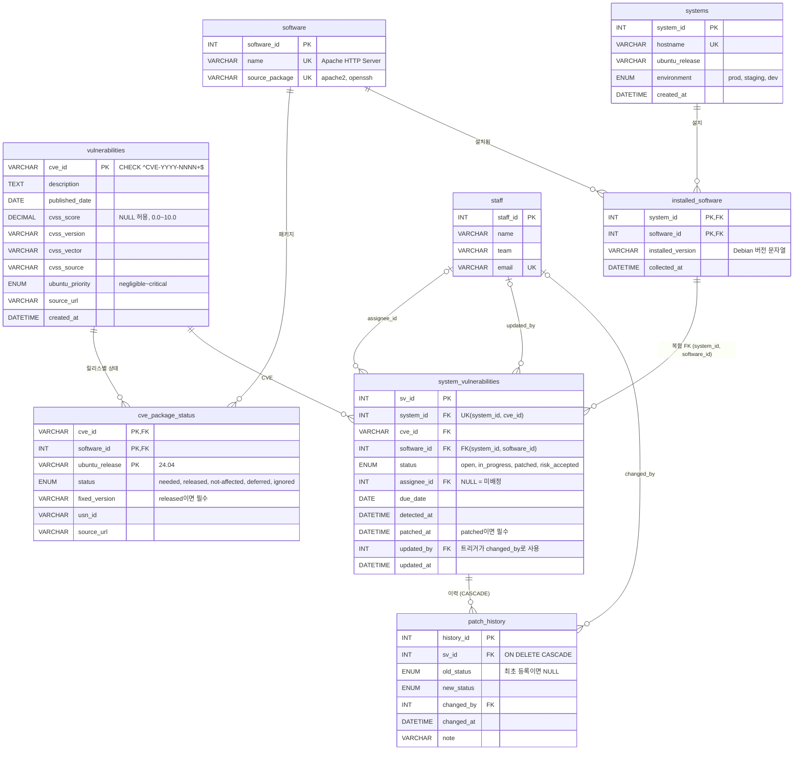

# ERD — vuln_mgmt

GitHub에서 Mermaid로 렌더링된다. 정의 원본은 `db/schema.sql`이며, 둘이 다르면 schema.sql이 맞다.

- **실제 데이터**(외부 수집): `software`, `vulnerabilities`, `cve_package_status`
- **가상 데이터**(운영 시뮬레이션): `systems`, `installed_software`, `staff`, `system_vulnerabilities`, `patch_history`

## 관계 요약

| 부모 | 자식 | FK 컬럼 | 카디널리티 | ON DELETE |
|---|---|---|---|---|
| vulnerabilities | cve_package_status | cve_id | 1 : N | RESTRICT |
| software | cve_package_status | software_id | 1 : N | RESTRICT |
| systems | installed_software | system_id | 1 : N | RESTRICT |
| software | installed_software | software_id | 1 : N | RESTRICT |
| installed_software | system_vulnerabilities | (system_id, software_id) | 1 : N | RESTRICT |
| vulnerabilities | system_vulnerabilities | cve_id | 1 : N | RESTRICT |
| staff | system_vulnerabilities | assignee_id (NULL 허용) | 0..1 : N | RESTRICT |
| staff | system_vulnerabilities | updated_by (NULL 허용) | 0..1 : N | RESTRICT |
| system_vulnerabilities | patch_history | sv_id | 1 : N | **CASCADE** |
| staff | patch_history | changed_by (NULL 허용) | 0..1 : N | RESTRICT |

`systems` ↔ `software`는 `installed_software`를 통한 M:N이고, `system_vulnerabilities`는
`installed_software`의 자식이므로 `system_id`, `software_id`는 각각 `systems`, `software`에도 간접적으로 묶인다.
